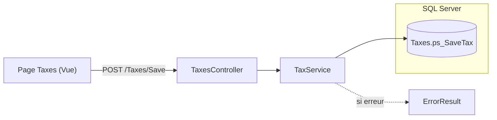
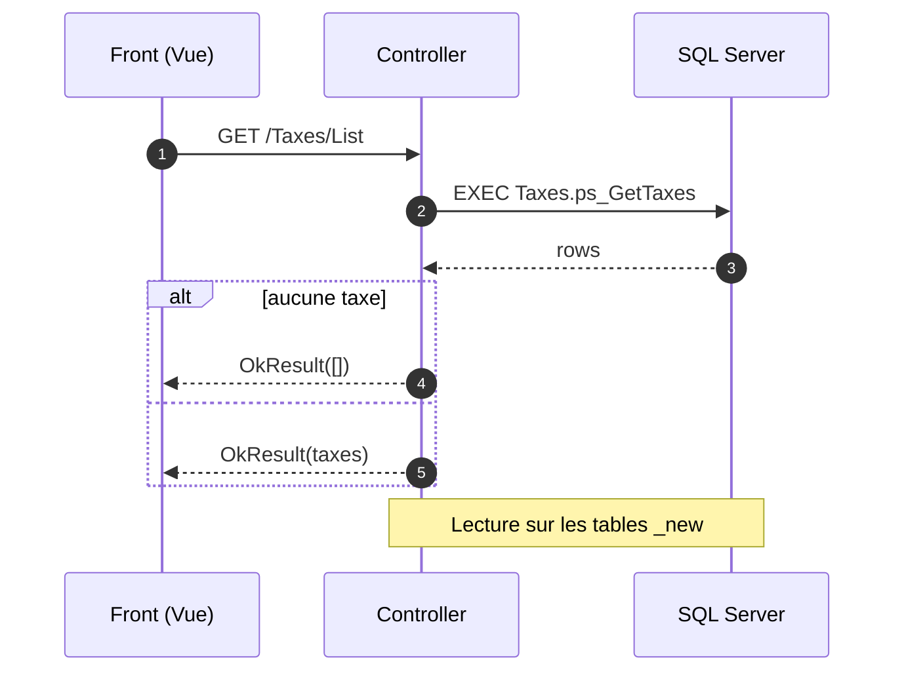
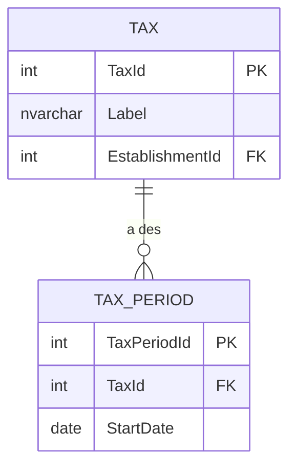
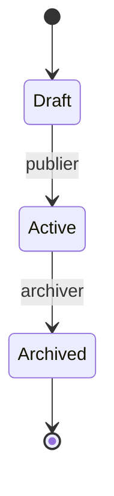
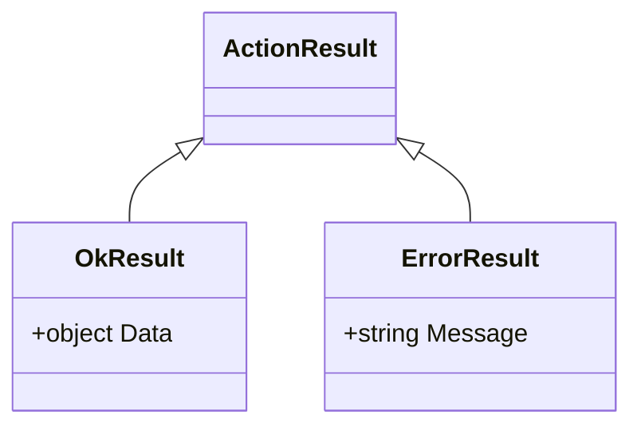
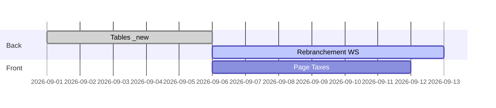
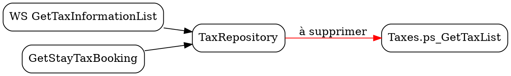
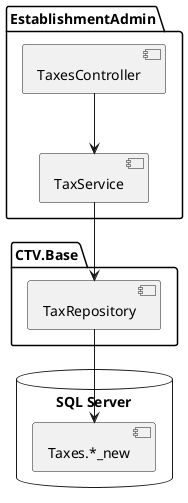

# Diagrammes dans Markdown Preview Enhanced

Sommaire :
1. Options communes
2. Mermaid (flowchart, séquence, ER, états, classes, gantt)
3. Graphviz (dot / viz)
4. Kroki (PlantUML, C4, d2, DBML, ditaa, svgbob, etc.)
5. vega-lite
6. wavedrom et bitfield
7. WebSequenceDiagrams (wsd)
8. TikZ
9. Pièges fréquents

## 1. Options communes

Les options s'écrivent entre accolades après le langage du bloc :
- `{code_block=true}` : affiche le code sans le rendre. Utile pour montrer la syntaxe.
- `{align="center"}` : centre le rendu.
- `{filename="schema.png"}` : nom du fichier image à l'export Markdown GFM.
- `{kroki=true}` ou `{kroki="type"}` : envoie le bloc à `https://kroki.io/<type>/svg`. Avec `true`, le type est le langage du bloc. Forme équivalente : langage ` ```kroki-<type> `.

## 2. Mermaid

Rendu local, thème `default`. Mettre les libellés entre guillemets dès qu'ils contiennent des caractères spéciaux.

### Flowchart



Directions : `LR`, `TD`, `RL`, `BT`. Formes : `[rect]`, `(arrondi)`, `([stade])`, `[(cylindre DB)]`, `{losange}`, `((cercle))`. Liens : `-->`, `-.->` (pointillé), `==>` (épais), `-->|"texte"|`. Style : `classDef warn fill:#fdd,stroke:#c00` puis `class NODE warn`.

### Séquence



Blocs : `alt/else/end`, `opt/end`, `loop/end`, `par/and/end`, `rect rgb(...)/end`. `activate X` / `deactivate X` pour les barres d'activation.

### ER (schéma de tables)



Cardinalités : `||` exactement un, `o|` zéro ou un, `}o` zéro ou plus, `}|` un ou plus.

### États



### Classes



### Gantt



## 3. Graphviz (dot / viz)

Rendu local via Viz.js, pas besoin du binaire Graphviz. Langage ` ```dot ` ou ` ```viz `. Moteur : `{engine="dot|neato|circo|osage|twopi"}`.



Choix du moteur : `dot` pour une hiérarchie ou un flux orienté, `neato` pour un graphe non orienté, `circo` pour un cycle, `twopi` pour une étoile autour d'un nœud central, `osage` pour des groupes imbriqués. `subgraph cluster_x { label="..."; ... }` dessine un cadre.

## 4. Kroki

Réseau requis (`https://kroki.io`). Le contenu du bloc part chez Kroki. Types utiles : `plantuml`, `c4plantuml`, `d2`, `dbml`, `erd`, `ditaa`, `svgbob`, `nomnoml`, `bpmn`, `blockdiag`, `seqdiag`, `actdiag`, `nwdiag`, `structurizr`, `excalidraw`, `wireviz`, `pikchr`.

### PlantUML

Toujours le langage `plantuml` (pas `puml`) avec `{kroki=true}`. `@startuml` / `@enduml` sont obligatoires pour Kroki.



### C4 (PlantUML)

```c4plantuml {kroki=true}
@startuml
!include <C4/C4_Container>
Person(user, "Gérant camping")
System_Boundary(sh, "Secureholiday") {
  Container(front, "EstablishmentAdmin", "Vue 3")
  Container(api, "CtvApi", ".NET")
  ContainerDb(db, "SQL Server")
}
Rel(user, front, "utilise")
Rel(front, api, "HTTP/JSON")
Rel(api, db, "procédures stockées")
@enduml
```

### d2

```d2 {kroki=true}
direction: right
front: EstablishmentAdmin {
  page: Page Taxes
}
back: CTV.Base {
  svc: TaxService
}
db: SQL Server {shape: cylinder}
front.page -> back.svc: POST /Taxes/Save
back.svc -> db: ps_SaveTax
```

Les options locales de d2 (`layout`, `theme`, `sketch`) ne passent pas par Kroki. Utilise les directives d2 dans le texte (`vars: { d2-config: { ... } }`) si besoin.

### DBML (schéma SQL avec colonnes)

Plus lisible que mermaid `erDiagram` quand les tables ont beaucoup de colonnes.

```dbml {kroki=true}
Table Taxes.Tax_new {
  TaxId int [pk]
  Label nvarchar
  EstablishmentId int
}
Table Taxes.TaxPeriod_new {
  TaxPeriodId int [pk]
  TaxId int [ref: > Taxes.Tax_new.TaxId]
  StartDate date
}
```

### ditaa / svgbob (ASCII art vers dessin)

```ditaa {kroki=true}
+--------+   +--------+   +----+
| Front  |-->|  API   |-->| DB |
+--------+   +--------+   +----+
```

## 5. vega-lite

Rendu local, statique. JSON ou YAML. Pour les chiffres : volumes, répartition, évolution.

```vega-lite
{
  "$schema": "https://vega.github.io/schema/vega-lite/v5.json",
  "data": {"values": [
    {"source": "Qenner", "erreurs": 42},
    {"source": "Phobs", "erreurs": 17},
    {"source": "Resalys", "erreurs": 8}
  ]},
  "mark": "bar",
  "encoding": {
    "x": {"field": "source", "type": "nominal", "sort": "-y"},
    "y": {"field": "erreurs", "type": "quantitative"}
  }
}
```

Données depuis un CSV : `@import "data.csv" {as="vega-lite"}` ne marche pas pour un CSV brut. Mets plutôt les valeurs dans `data.values`, ou importe un fichier `.json` vega-lite : `@import "chart.json" {as="vega-lite"}`.

## 6. wavedrom et bitfield

Chronogramme :

```wavedrom
{ "signal": [
  { "name": "clk",  "wave": "p......" },
  { "name": "req",  "wave": "0.1..0." },
  { "name": "ack",  "wave": "0..1.0." }
]}
```

Champs de bits (registre, masque de flags) :

```bitfield
[
  {"bits": 1, "name": "IsActive"},
  {"bits": 1, "name": "IsPms"},
  {"bits": 6, "name": "réservé"}
]
```

## 7. WebSequenceDiagrams (wsd)

Réseau requis. Préfère mermaid `sequenceDiagram`, sauf demande explicite.

```wsd
Front->API: GET /taxes
API->DB: ps_GetTaxes
DB-->API: rows
API-->Front: OkResult
```

## 8. TikZ

Rendu via node-tikzjax en local, sinon via tikzjax.com (réseau). `\begin{document}` est requis. Packages chargés automatiquement si détectés : tikz-cd, pgfplots, circuitikz, chemfig, tikz-3dplot. Réserve TikZ aux figures mathématiques précises (courbes, géométrie). Pour un schéma d'architecture, mermaid ou d2 vont plus vite.

```tikz
\begin{document}
\begin{tikzpicture}
  \draw[->] (0,0) -- (4,0) node[right] {$t$};
  \draw[->] (0,0) -- (0,3) node[above] {montant};
  \draw[thick, blue] (0,0.5) -- (2,0.5) -- (2,2) -- (4,2);
\end{tikzpicture}
\end{document}
```

## 9. Pièges fréquents

- Mermaid : `end` en minuscules comme id de nœud casse le flowchart. Écris `End` ou `fin`.
- Mermaid : libellé avec `()`, `[]`, `{}`, `:`, `/`, `#` ou `;` sans guillemets, donc erreur de parsing. Entoure de `"..."`.
- Mermaid ER : les noms d'entités avec un point (`Taxes.Tax_new`) cassent le parsing. Écris `Tax_new` et précise le schéma dans le texte, ou passe à DBML.
- Kroki : `puml {kroki=true}` envoie vers `/puml/`, type inconnu. Écris `plantuml {kroki=true}`.
- Kroki PlantUML : oubli de `@startuml` / `@enduml`, donc erreur 400.
- Graphviz : un id avec espaces ou points sans guillemets casse le graphe. Entoure de `"..."`.
- Un diagramme qui ne rend pas affiche une erreur dans la preview. Si tu ne peux pas vérifier le rendu, garde une syntaxe simple et signale le bloc à l'utilisateur.
