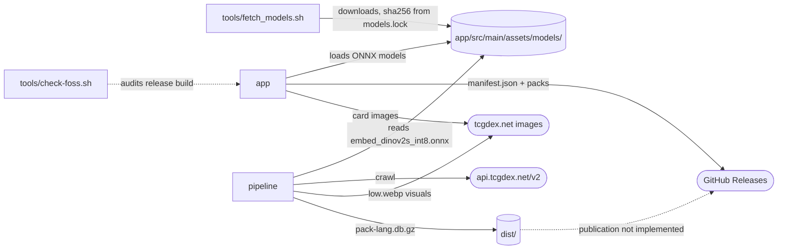

# tgc-scan-app — repository map

> Repository `tgc-scan-app` (single git repository, root = project root). Checked on 2026-11-12 from `settings.gradle.kts`, `tools/`, `pipeline/tcgscan_pipeline/config.py`, `app/src/main/java/org/tcgscan/app/AppConfig.kt`, `app/src/main/java/org/tcgscan/app/ui/image/CardImage.kt` (working tree of branch `feat/v1`, partly uncommitted).

## Projects

| Project | Sheet | Role |
|---|---|---|
| `app/` | [app](app/vue-ensemble.md) | Android app (Kotlin, Compose, Room, ONNX Runtime, OpenCV): scans cards, matches them against an installed language pack, manages the collection. Only Gradle module (`include(":app")`). |
| `pipeline/` | [pipeline](pipeline/vue-ensemble.md) | Python pipeline: crawls TCGdex, embeds card visuals with the app's own model, builds `pack-<lang>.db.gz`. |

## Folders without code

- `tools/`: `fetch_models.sh` downloads the ML models into `app/src/main/assets/models/`, verified against `models.lock`; `check-foss.sh` audits the app's release classpath (no Google Play services, ML Kit, Firebase) and its merged manifest (permissions, ONNX telemetry).
- `gradle/`: version catalog `libs.versions.toml` and Gradle wrapper.
- `docs/`: public docs linked from the README (`pack-format.md`, `models.md`, `benchmark.md`, `plans/`) plus this Claude docs folder (see `INDEX.md`).
- Root files: `SPEC.md` (v1 specification), `README.md`, Gradle root build (`build.gradle.kts`, `settings.gradle.kts`, `gradle.properties`).

## Dependencies between projects

What to look at: `app` and `pipeline` never import each other. They meet on two shared artefacts, the model file in the app's assets and the pack file (contract: [pack format](../../pack-format.md)).

Sources of each arrow: `tools/fetch_models.sh` (`DEST_DIR`); `tools/check-foss.sh` (`releaseRuntimeClasspath`, merged manifest); `pipeline/tcgscan_pipeline/config.py` (`EMBED_MODEL_ASSET`, `MODELS_DIR`, `API_BASE`, `DEFAULT_OUT_DIR`); `pipeline/tcgscan_pipeline/images.py` (host allow-list); `AppConfig.kt` (`RELEASE_DOWNLOAD_BASE`); `CardImage.kt` (`https://assets.tcgdex.net/`).

> [!WARNING]
> The pack publication chain is incomplete. `pipeline/README.md` and `docs/pack-format.md` describe `manifest.py`, `guard.py`, `cli.py` and `.github/workflows/packs.yml`; none exist in the working tree. `AppConfig.GITHUB_REPO` is still the placeholder `CHANGE-ME-OWNER/tcg-scan-app`. Details in the [pipeline sheet](pipeline/vue-ensemble.md).
